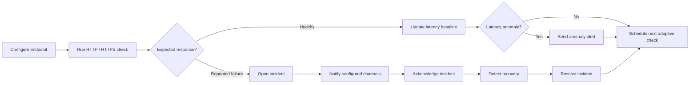
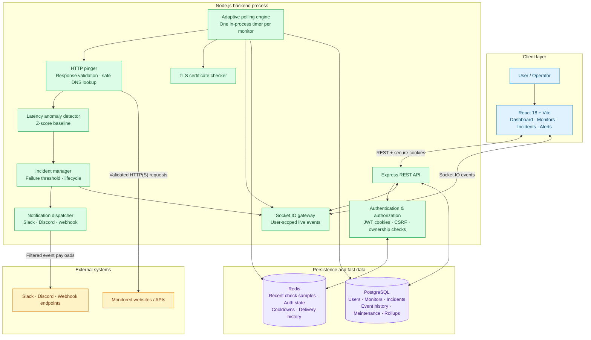
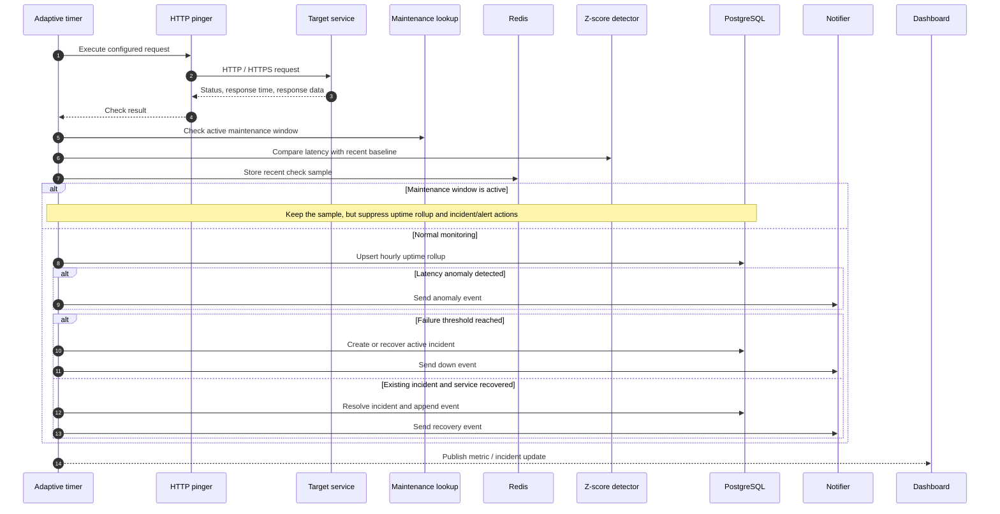
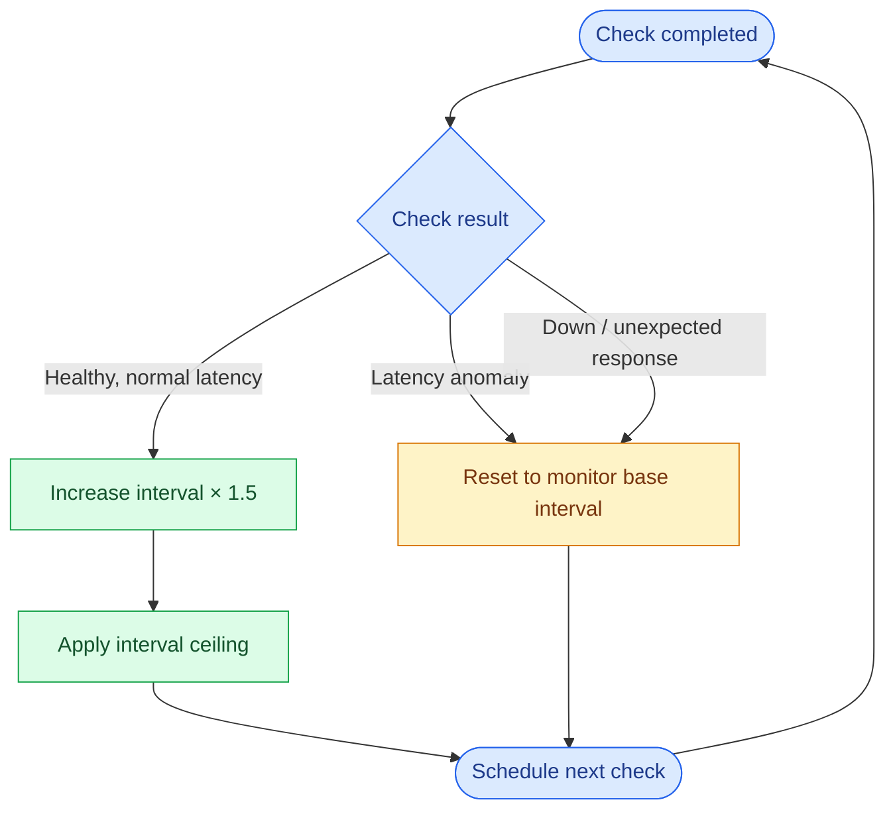
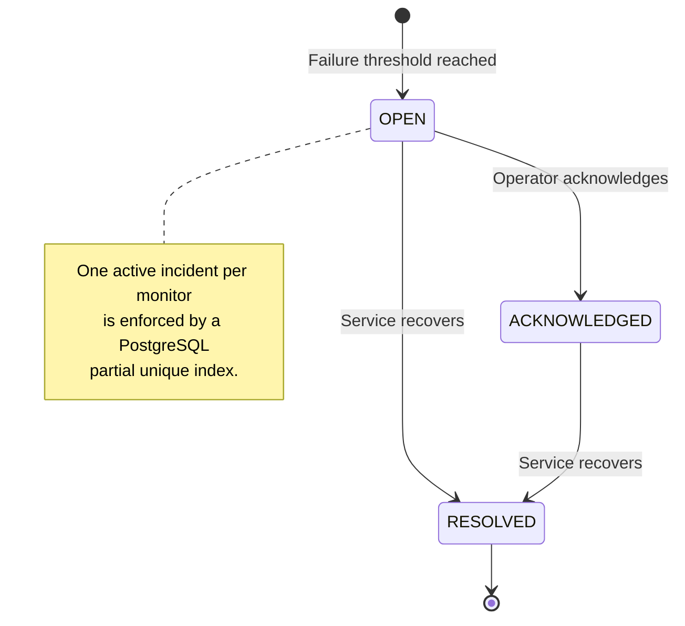
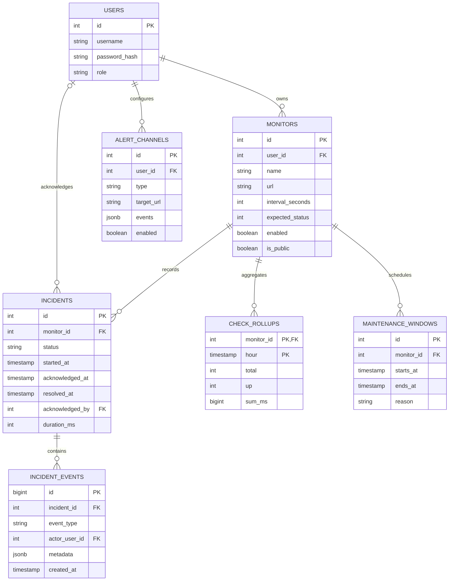

<!--
  PulseWatch README
  Audience: recruiters, engineering interviewers, and developers evaluating the project.
  Diagrams are Mermaid so they remain editable and render natively on GitHub.
-->

<div align="center">

# ⚡ PulseWatch

### Real-time uptime monitoring and incident response

**Know when a service goes down. Understand what changed. Notify the right people.**

PulseWatch is a full-stack monitoring platform that checks HTTP/HTTPS endpoints, adapts its polling frequency to service health, detects unusual latency, tracks incidents, and delivers configurable alerts.

<p>
  <a href="https://github.com/Neemasree/PULSEWATCH/actions/workflows/ci.yml">
    
  </a>
  
  
  
  
  
</p>

<p>
  <a href="#-product-overview">Product overview</a> ·
  <a href="#-architecture">Architecture</a> ·
  <a href="#-key-engineering">Engineering</a> ·
  <a href="#-run-locally">Run locally</a> ·
  <a href="docs/PLACEMENT_DEMO.md">Placement walkthrough</a>
</p>

</div>

---

## Why PulseWatch?

When a website or API becomes unavailable, teams need more than a simple ping. They need to know **which service failed, when the incident began, whether latency is degrading, who has acknowledged it, and whether the service has recovered**.

PulseWatch brings those workflows into one dashboard:

- Monitor HTTP and HTTPS endpoints with configurable request expectations.
- Reduce unnecessary checks while services are healthy using adaptive polling.
- Detect unusual response-time changes with a statistical Z-score baseline.
- Turn repeated failures into a persistent incident with an auditable lifecycle.
- Send event-filtered notifications to Slack, Discord, or a custom webhook.
- Review uptime, latency, incidents, SSL expiry, and maintenance windows.

### A measured efficiency result

<div align="center">

| **82%** | **188 vs 1,031** |
|:---:|:---:|
| Fewer checks in a local benchmark | Adaptive checks vs. a fixed 10-second polling baseline |

</div>

The benchmark used six healthy monitors and compared a local adaptive-polling run with a hypothetical fixed 10-second schedule. It represents steady-state healthy monitoring, not a guaranteed saving for every workload. Failing or anomalous monitors return to the faster base interval.

---

## Product overview

| Area | What it does |
|---|---|
| **Live dashboard** | Shows monitor health, latest latency, anomaly indicators, polling statistics, and real-time updates |
| **Monitor management** | Create, edit, pause, resume, and delete endpoint checks; configure method, expected status, request headers/body, keyword rules, timeout, and failure threshold |
| **Monitor insights** | Review latency history, uptime, average latency, incident counts, SSL expiry, and CSV exports |
| **Incident response** | Track incidents through Open → Acknowledged → Resolved and inspect the persisted event timeline |
| **Alert channels** | Configure Slack, Discord, or generic webhooks with event filters, test delivery, and delivery history |
| **Maintenance windows** | Schedule planned maintenance so checks are not counted in uptime rollups and incident/alert actions are suppressed during the window |
| **Public status page** | Publish selected monitors and their current status and incident history without exposing private monitors |

### The monitoring lifecycle at a glance



---

## Architecture

PulseWatch is organized around a React client, an Express API and monitoring process, and two complementary data stores. The backend currently runs the polling loops in-process; this is intentionally called out in the scaling limitations below.

### 1. System architecture



### 2. What happens during a monitor check?



### 3. Adaptive polling strategy

Each monitor has its own base interval. The interval increases gradually after healthy checks and returns to the base interval when the monitor is down or an anomaly is detected.



**Polling rules implemented in the backend:**

- Base interval is at least **5 seconds**.
- Each healthy check multiplies the current interval by **1.5**.
- The interval is capped at the greater of **60 seconds** or the configured base interval.
- A down result or a latency anomaly resets the interval to the monitor's base.
- A check is considered healthy only when its HTTP status matches the monitor's configured expected status and no request/keyword failure was reported.

### 4. Incident lifecycle



Incident records and lifecycle events are stored in PostgreSQL. The database constraint prevents two concurrent active incidents for the same monitor; the in-memory poller state is only a fast runtime guard.

### 5. Persistent data model



**Storage choices:** PostgreSQL is the durable source for accounts, monitor configuration, incidents, event history, maintenance windows, alert-channel configuration, and hourly rollups. Redis holds recent high-frequency check samples and short-lived or operational state such as token revocation, login lockout, alert cooldowns, and recent delivery history.

---

## Key engineering

### Monitoring and anomaly detection

- Supports configurable HTTP request methods, headers, request bodies, expected status codes, timeouts, failure thresholds, and keyword validation.
- Uses a rolling in-memory window of recent successful response times for the anomaly baseline.
- Requires at least 10 historical readings before evaluating an anomaly.
- Computes the Z-score: (z = \frac{x - \mu}{\sigma}\).
- Flags a reading when the absolute Z-score is greater than 3.
- Handles insufficient history and a zero-standard-deviation baseline explicitly.

The detector is intentionally understandable and testable as a pure function. Its statistical trade-offs are documented below.

### Incident correctness and recovery

- Repeated failures must reach the monitor's configured failure threshold before a confirmed outage is recorded.
- A partial unique index on active incident statuses enforces one active incident per monitor at the database layer.
- Active incidents are reloaded from PostgreSQL so restart recovery does not rely only on volatile memory.
- Open, acknowledged, and resolved actions are appended to a queryable incident event timeline.
- Maintenance windows suppress incident and alert actions and are excluded from hourly uptime rollups.

### Real-time dashboard

- Socket.IO delivers monitor metrics, polling statistics, monitor changes, and incident updates.
- User data is emitted to owner-scoped rooms; admin updates use the explicit admin room.
- The dashboard combines live events with API-loaded monitor configuration.
- The monitor detail view includes latency history and selectable 24-hour, 7-day, 30-day, and 90-day statistics.

### Alerts and SSL monitoring

| Event | Description |
|---|---|
| `down` | Monitor reaches its configured failure threshold |
| `recovered` | A previously active incident is resolved |
| `anomaly` | A successful response has an anomalous latency reading |
| `ssl_expiring` | HTTPS certificate reaches the 14-, 7-, or 1-day warning threshold |

Alert channels support **Slack**, **Discord**, and **generic webhooks**. Users can select event types, enable or disable a channel, send a test notification, and inspect recent delivery history. Webhook delivery retries failed attempts up to three times.

### Security and privacy

Security controls are applied on both the API and outbound monitoring paths:

- JWT access and refresh tokens are stored in **httpOnly cookies**; refresh tokens rotate and are consumed atomically.
- CSRF validation protects browser state-changing requests.
- Login and registration endpoints use rate limits; account lockout adds a separate credential-abuse control.
- Passwords are hashed with bcrypt.
- Helmet security headers and an explicit CORS allow-list protect the API boundary.
- User-owned monitor, incident, and alert-channel queries are ownership-scoped; admin access is checked server-side.
- Socket.IO messages are separated into owner/admin rooms.
- User-supplied monitor and webhook URLs are checked against private and special-use IP ranges; DNS is revalidated at connection time and redirects are disabled to reduce SSRF and DNS-rebinding risk.
- Request bodies, outbound response sizes, and custom request headers have explicit limits.
- PostgreSQL TLS certificate verification is enabled by default for hosted database connections.

---

## Technology stack

| Layer | Technologies | Responsibility |
|---|---|---|
| Frontend | React 18, Vite, React Router | Dashboard, monitor management, incident and alert views, public status page |
| Charts | Chart.js, react-chartjs-2 | Latency and monitoring visualizations |
| Backend | Node.js 20, Express 4 | REST API, authentication, validation, monitor orchestration |
| Real-time | Socket.IO | Live metrics and incident events |
| Relational data | PostgreSQL 16, node-postgres | Durable application data and hourly rollups |
| Fast state | Redis 7, ioredis | Recent metrics, auth state, cooldowns, delivery history |
| HTTP checks | Axios, Node HTTP agents | Endpoint checks and outbound notifications |
| Validation & security | Zod, Helmet, CORS, bcrypt, JWT | Input validation, secure sessions, API protection |
| API documentation | OpenAPI 3.0, Swagger UI | Contract and interactive endpoint reference |
| Infrastructure | Docker, Docker Compose, Nginx | Repeatable local multi-service environment |
| Quality | Jest, Supertest, Playwright, GitHub Actions | Unit/integration tests, browser workflows, CI |

---

## API overview

The API is rooted at `/api`. The version-controlled OpenAPI contract is in [`backend/openapi.yaml`](backend/openapi.yaml), with Swagger UI served at `/api/docs` (production access is restricted to admins).

| Area | Representative endpoints | Purpose |
|---|---|---|
| Authentication | `POST /auth/register`, `/login`, `/refresh`, `/logout`; `GET /auth/me` | Account creation, secure session lifecycle |
| Monitors | `GET/POST /monitors`, `GET/PATCH/DELETE /monitors/{id}` | Manage endpoint configuration |
| Monitor controls | `POST /monitors/{id}/pause`, `/resume` | Control polling |
| Statistics | `GET /monitors/{id}/stats`, `/export.csv`, `/report.csv` | Read metrics and export reports |
| Incidents | `GET /incidents`, `/incidents/{id}/events`, `POST /incidents/{id}/acknowledge` | Incident history and response |
| Maintenance | `GET/POST /monitors/{id}/maintenance`, `DELETE /maintenance/{id}` | Planned maintenance windows |
| Alert channels | `GET/POST /alert-channels`, `PATCH/DELETE /alert-channels/{id}` | Manage notification destinations |
| Public status | `GET /public/status`, `/public/incidents` | Expose only explicitly public monitors |
| Health | `GET /health`, `/api/health` | Service health checks |

---

## Run locally

### Option A — Docker Compose (recommended)

**Prerequisites:** Git, Docker Desktop / Docker Engine, and Docker Compose.

1. Clone the repository and enter the project:

   ```bash
   git clone https://github.com/Neemasree/PULSEWATCH.git
   cd PULSEWATCH
   ```

2. Create the backend environment file:

   ```bash
   cp backend/.env.example backend/.env
   ```

3. Edit `backend/.env` and set:
   - `ADMIN_USERNAME` and `ADMIN_PASSWORD`
   - `JWT_ACCESS_SECRET` and `JWT_REFRESH_SECRET` to two different random values

   Generate a secret with:

   ```bash
   node -e "console.log(require('crypto').randomBytes(64).toString('hex'))"
   ```

4. Start the complete local stack:

   ```bash
   docker compose up --build
   ```

5. Open the application:

   | Service | Local address |
   |---|---|
   | PulseWatch dashboard | http://localhost:8080 |
   | Backend health check | http://localhost:3000/health |
   | Swagger UI | http://localhost:3000/api/docs |

Docker Compose starts **React/Nginx, the Express API, PostgreSQL, and Redis**. Database migrations run during backend startup. The published container ports bind to loopback for local development.

To stop the stack:

```bash
docker compose down
```

### Option B — Run frontend and backend separately

**Prerequisites:** Node.js 20, npm, PostgreSQL 16, and Redis 7.

1. Start PostgreSQL and Redis, then configure their local connection values in `backend/.env`.
2. Install and start the backend:

   ```bash
   cd backend
   cp .env.example .env
   npm ci
   npm run migrate
   npm run dev
   ```

3. In a second terminal, install and start the frontend:

   ```bash
   cd frontend
   npm ci
   npm run dev
   ```

4. Open http://localhost:5173.

The local Vite origin is included in the example CORS configuration. Set the database credentials, Redis connection, admin bootstrap credentials, and two distinct JWT secrets in the environment file before starting.

### Useful environment variables

| Variable | Purpose |
|---|---|
| `PORT` | API port (default: 3000) |
| `NODE_ENV` | Runtime environment |
| `DATABASE_URL` | PostgreSQL connection string |
| `DATABASE_SSL_REJECT_UNAUTHORIZED` | PostgreSQL TLS certificate verification (enabled by default) |
| `REDIS_URL` or `REDIS_HOST` / `REDIS_PORT` | Redis connection |
| `ALLOWED_ORIGIN` | Comma-separated frontend origins |
| `JWT_ACCESS_SECRET`, `JWT_REFRESH_SECRET` | Distinct JWT signing secrets |
| `ADMIN_USERNAME`, `ADMIN_PASSWORD` | First admin account bootstrap |
| `TRUST_PROXY` | Explicit trusted proxy configuration |
| `MAX_MONITORS_PER_USER` | Per-user monitor quota |
| `SLACK_WEBHOOK_URL` | Optional legacy Slack webhook destination |

See [`backend/.env.example`](backend/.env.example) for the complete configuration reference. Never commit real credentials or webhook URLs.

---

## Testing and continuous integration

The GitHub Actions workflow runs on pushes and pull requests. It provisions PostgreSQL and Redis service containers and validates the application in separate jobs.

| CI job | What it verifies |
|---|---|
| **Backend tests and frontend build** | Applies migrations, runs Jest, and creates the Vite production build |
| **Browser end-to-end workflows** | Starts the API and frontend, then exercises real browser flows with Playwright |

The latest successful run recorded **242 passing Jest tests across 24 suites**, alongside a successful frontend build and browser end-to-end workflow.

[](https://github.com/Neemasree/PULSEWATCH/actions)

Run checks locally:

```bash
# Backend unit and integration tests
cd backend
npm ci
npm test

# Frontend production build
cd ../frontend
npm ci
npm run build
```

Test coverage includes authentication and CSRF, monitor CRUD and ownership, polling behavior, incidents and recovery, alert delivery, anomaly detection, SSL checks, request hardening, and SSRF protections.

---

## Engineering decisions and trade-offs

| Decision | Why it was chosen | Trade-off |
|---|---|---|
| PostgreSQL + Redis | Durable relational records and hourly aggregates belong in PostgreSQL; recent samples and expiring operational state fit Redis | The application must handle Redis availability separately from durable database state |
| Adaptive polling | Healthy services need fewer requests; suspicious or failed services need faster follow-up checks | Polling state is currently process-local and requires coordination before horizontal scaling |
| Database-enforced active incident uniqueness | A partial unique index protects against concurrent duplicate incident creation | The application must handle unique-constraint conflicts by recovering the existing incident |
| Hourly rollups | Long-range uptime summaries do not depend on the short recent-sample window | Historical charts are aggregated rather than storing every raw check indefinitely in PostgreSQL |
| Z-score anomaly detection | A small, explainable detector is easy to test and reason about | It is sensitive to small samples and skewed latency distributions |
| Cookie-based sessions + CSRF | httpOnly cookies reduce direct JavaScript access to session tokens | Browser mutations must send the CSRF header and the frontend must use credentialed requests |

---

## Known limitations and next engineering steps

PulseWatch is a strong full-stack project and is suitable for a technical walkthrough. The following are explicit boundaries—not features that should be claimed as complete:

1. **Single-instance polling:** checks are scheduled with in-process timers. Do not run multiple backend replicas for the same monitor set until a distributed queue or lease-based scheduler assigns one owner per monitor.
2. **Anomaly model:** the current detector uses Z-score. Median absolute deviation (MAD) or EWMA could improve robustness for skewed latency distributions and changing baselines.
3. **Email notifications:** email delivery is not implemented. Supported alert channels are Slack, Discord, and generic webhooks.
4. **Redis outage behavior:** down-alert cooldown acquisition fails open when Redis is unavailable, prioritizing the outage notification path; duplicate alerts may occur during a Redis outage.
5. **Deployment validation:** Docker Compose and CI are provided, but live-host deployment behavior has not been validated as part of this project pass.

### Future improvements

- Move the polling scheduler to BullMQ or a distributed lease-backed worker model.
- Add idempotent notification delivery and stronger retry observability.
- Evaluate MAD/EWMA anomaly detection against representative latency distributions.
- Add email notifications and operational dashboards for queue and worker health.
- Run a production deployment with managed PostgreSQL/Redis and verify TLS, proxy, secrets, and uptime behavior.

---

## Placement walkthrough

For a concise live demonstration and interview preparation, see **[`docs/PLACEMENT_DEMO.md`](docs/PLACEMENT_DEMO.md)**. It includes a 3–5 minute demo flow, architecture talking points, key trade-offs, local run commands, and questions worth rehearsing.

### Suggested 3-minute demo

1. Sign in and show the dashboard's live monitor states and adaptive polling statistics.
2. Open a monitor and explain expected-status validation, latency history, and uptime ranges.
3. Show an incident's lifecycle and persisted event timeline.
4. Configure a webhook channel, select events, and demonstrate the test-send and delivery history.
5. Open the public status page and explain why only explicitly public monitors appear.

---

<div align="center">

**Built to make service health visible and incident response explainable.**

[Repository](https://github.com/Neemasree/PULSEWATCH) ·
[CI workflows](https://github.com/Neemasree/PULSEWATCH/actions) ·
[Placement walkthrough](docs/PLACEMENT_DEMO.md) ·
[MIT License](LICENSE)

</div>
