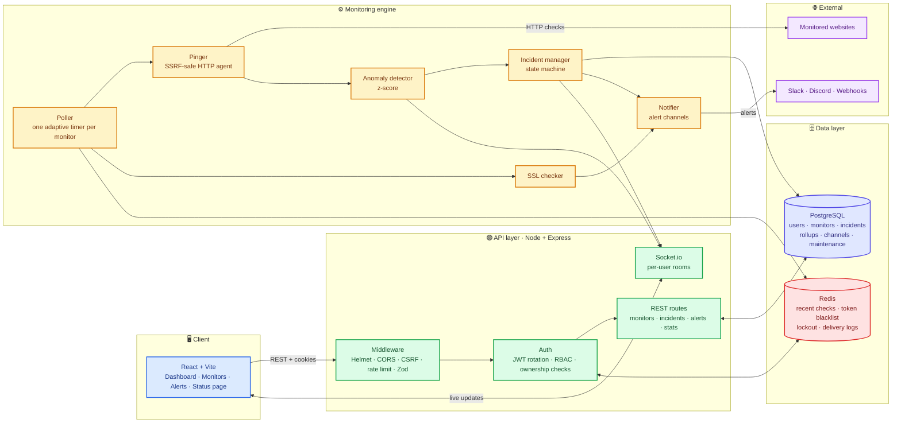
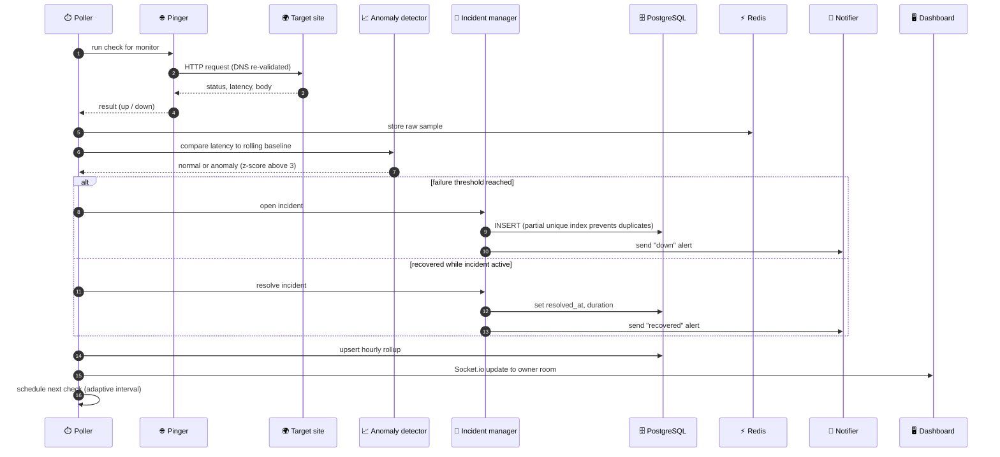
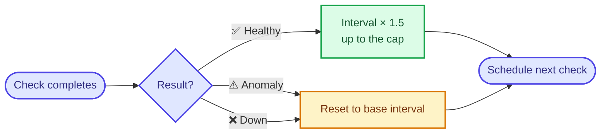
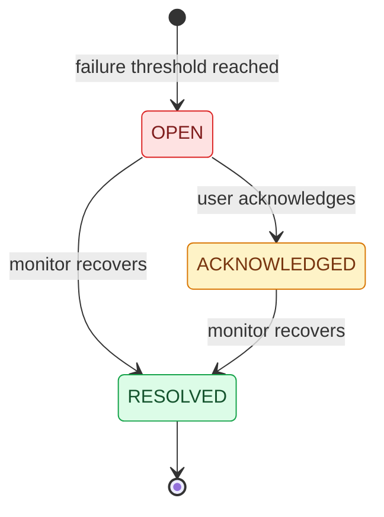

<div align="center">

# ⚡ PulseWatch

### Real-time uptime monitoring & incident response platform

Adaptive polling · Z-score anomaly detection · Incident lifecycle · SSL & maintenance controls · Multi-channel alerts

<br/>

[](https://YOUR-VERCEL-URL)
[](https://YOUR-RENDER-URL/health)
[](https://github.com/Neemasree/PULSEWATCH/actions)
[](#-testing--ci)


</div>

<br/>

<!-- Replace with your own screenshot: save it as docs/screenshots/dashboard.png -->
<p align="center">
  
</p>

---

## 📊 Results

| Metric | Value |
|---|---|
| **Check volume reduction** (adaptive vs fixed 10s polling) | **82%**: 188 adaptive checks vs 1,031 for the fixed baseline |
| Test suite | **119 tests** across 9 suites, run against real PostgreSQL and Redis in CI |
| Anomaly detector coverage | **100%** statements, branches, functions and lines |

> Measured in a local run with 6 healthy monitors. The baseline is a hypothetical fixed 10-second poll, and the figure reflects steady state with healthy monitors; failing or anomalous monitors poll faster, which lowers the saving.

---

## ✨ Features

<table>
<tr>
<td width="50%" valign="top">

### 📡 Monitoring
- GET / HEAD / POST checks with custom headers and body
- Expected status code, keyword present / absent checks
- Configurable timeout and failure threshold
- **Adaptive polling** that backs off while healthy
- **Z-score anomaly detection** on latency
- **SSL expiry checks** (alerts at 14, 7 and 1 days)
- **Maintenance windows** that silence planned downtime

</td>
<td width="50%" valign="top">

### 🚨 Incident response
- Lifecycle: `OPEN → ACKNOWLEDGED → RESOLVED`
- **One active incident per monitor**, enforced by a partial unique index
- Stats: uptime %, MTTR, avg latency, p50 / p95 / p99
- Hourly rollups in PostgreSQL
- CSV export of checks and hourly reports
- Public status page for chosen monitors

</td>
</tr>
<tr>
<td width="50%" valign="top">

### 🔔 Alerting
- Slack, Discord and generic webhook channels
- Per-channel event filters: `down` · `recovered` · `anomaly` · `ssl_expiring`
- Test-send button and delivery log
- Webhook destinations re-validated against SSRF

</td>
<td width="50%" valign="top">

### 🔐 Security
- JWT access + refresh in httpOnly cookies, **rotation**
- Redis-backed **token blacklist** and **login lockout**
- CSRF protection, Helmet, CORS allow-list, rate limiting
- **SSRF and DNS-rebinding protection**
- Ownership-scoped queries, per-user Socket.io rooms

</td>
</tr>
</table>

---

## 🏗️ Architecture

### System overview



> 🟦 client &nbsp; 🟩 API &nbsp; 🟨 monitoring engine &nbsp; 🟪 PostgreSQL / external &nbsp; 🟥 Redis

### What happens on every check



### Adaptive polling



A healthy monitor settles at the cap (60 s with the default base), a saving of about 1 − 10/60 ≈ 83% against a fixed 10 s baseline. Any anomaly or failure drops it straight back to the fast interval, so problems are never watched slowly.

### Incident lifecycle



A partial unique index on `incidents(monitor_id) WHERE status IN ('OPEN','ACKNOWLEDGED')` guarantees at most one active incident per monitor, even if two checks race.

---

## 🧠 Design decisions

<details>
<summary><b>Why PostgreSQL and Redis together?</b></summary>
<br/>

Configuration, incidents and aggregated history must be durable and queryable, so they live in PostgreSQL. High-frequency raw samples, auth state with TTLs and delivery logs suit Redis. Raw checks are not stored in PostgreSQL; they are rolled up hourly to keep the database small. Percentiles use the latest 500 Redis samples, while uptime and averages come from hourly rollups.
</details>

<details>
<summary><b>Why gradual back-off for adaptive polling?</b></summary>
<br/>

Jumping straight to a long interval would leave a blind spot just after recovery. Growing by ×1.5 per healthy check (similar to TCP slow-start) cuts load quickly while still reacting fast: any anomaly or failure resets to the base interval.
</details>

<details>
<summary><b>Why enforce incident uniqueness in the database?</b></summary>
<br/>

Application-level "check then insert" logic can race. A partial unique index makes duplicate active incidents impossible regardless of timing or the number of workers.
</details>

<details>
<summary><b>Why keep auth state in Redis?</b></summary>
<br/>

The refresh-token blacklist and login lockout counters use Redis keys with TTLs, so a restart never revives a revoked token or resets a lockout.
</details>

<details>
<summary><b>How is SSRF handled?</b></summary>
<br/>

User-supplied URLs (monitors and webhook destinations) are validated on save and again on use. Private, loopback and link-local addresses are rejected, and DNS is checked at connection time to defeat rebinding.
</details>

---

## 🚀 Getting started

### With Docker (recommended)

```bash
git clone https://github.com/Neemasree/PULSEWATCH.git
cd PULSEWATCH
cp backend/.env.example backend/.env
# edit backend/.env: set JWT secrets, ADMIN_USERNAME and ADMIN_PASSWORD
docker compose up --build
```

| Service | URL |
|---|---|
| Dashboard | http://localhost:8080 |
| Backend API | http://localhost:3000 |

Generate each JWT secret with:

```bash
node -e "console.log(require('crypto').randomBytes(64).toString('hex'))"
```

### Without Docker

```bash
# backend (needs PostgreSQL and Redis running)
cd backend && npm install && npm run migrate && npm run dev

# frontend
cd frontend && npm install && npm run dev
```

<details>
<summary><b>Environment variables</b></summary>
<br/>

| Variable | Description |
|---|---|
| `PORT` | Backend port (default 3000) |
| `NODE_ENV` | `development` or `production` |
| `DATABASE_URL` | PostgreSQL connection string |
| `DATABASE_SSL` | Set to `false` for local Postgres without SSL |
| `REDIS_URL` or `REDIS_HOST` / `REDIS_PORT` | Redis connection |
| `ALLOWED_ORIGIN` | Frontend origin(s) for CORS, comma-separated |
| `JWT_ACCESS_SECRET`, `JWT_REFRESH_SECRET` | Required in production, use different values |
| `ADMIN_USERNAME`, `ADMIN_PASSWORD` | Bootstrap admin, created only if none exists |
| `TRUST_PROXY` | `false` locally, `1` behind Render / Vercel |
| `SLACK_WEBHOOK_URL` | Optional legacy fallback alert destination |

</details>

---

## 🔌 API overview

OpenAPI docs are served at `/api/docs` (open in development, admin-only in production).

<details>
<summary><b>Show routes</b></summary>
<br/>

| Area | Routes |
|---|---|
| Auth | `POST /api/auth/register`, `/login`, `/refresh`, `/logout`, `GET /api/auth/me` |
| Monitors | `GET/POST /api/monitors`, `GET/PATCH/DELETE /api/monitors/:id`, `POST /:id/pause`, `POST /:id/resume` |
| Monitor data | `GET /api/monitors/:id/stats`, `/export.csv`, `/report.csv`, `GET /api/history?monitorId=`, `GET /api/status` |
| Incidents | `GET /api/incidents`, `GET /api/incidents/:id/events`, `POST /api/incidents/:id/acknowledge` |
| Alert channels | `GET/POST /api/alert-channels`, `PATCH/DELETE /:id`, `POST /:id/test`, `GET /:id/deliveries` |
| Maintenance | `GET/POST /api/monitors/:id/maintenance`, `DELETE /api/maintenance/:id` |
| Public | `GET /api/public/status`, `GET /api/public/incidents` |
| Health | `GET /health`, `GET /api/health` |

**Socket.io events (server to client):** `history`, `metric-update`, `polling-stats`, `incident-update`. Each is sent only to the owning user's room (and admins).

</details>

---

## 🧪 Testing & CI

```bash
cd backend
npm test                 # 9 suites, 119 tests
npm test -- --coverage   # coverage report
```

Suites cover monitor CRUD and validation, incident transitions, ownership scoping, SSRF protection, auth hardening, Redis-backed auth state, the polling pipeline and anomaly detection.

GitHub Actions ([`ci.yml`](.github/workflows/ci.yml)) runs on every push and pull request: it starts PostgreSQL 16 and Redis 7 service containers, applies migrations, runs the backend tests, and builds the frontend.

---

## ☁️ Deployment

| Part | Platform | Notes |
|---|---|---|
| Frontend | Vercel | `vercel.json` rewrites all routes to `index.html` |
| Backend | Render | `render.yaml` provisions the web service, PostgreSQL and Redis with generated JWT secrets and a `/health` check |

> Free-tier instances sleep when idle, which pauses background polling. Use an always-on instance for continuous monitoring.

---

## ⚠️ Known limitations and current scope

- **Single-instance polling:** polling still runs in-process with `setTimeout`. Do not scale the backend horizontally until polling ownership is coordinated through a shared scheduler/queue (for example, BullMQ) or a distributed lease.
- **Anomaly model:** Z-score detection can be sensitive to skewed latency distributions and small samples. MAD or EWMA is a future improvement; review alerts against your workload before treating them as definitive.
- **Email alerts:** email delivery is not implemented. Current supported alert channels are Slack, Discord and generic webhooks.
- **Redis outage behavior:** down-alert cooldown acquisition fails open if Redis is unavailable, prioritizing outage notifications over duplicate suppression during the outage.
- **MTTA definition:** MTTA is currently calculated from the incident's `started_at` to `acknowledged_at`; incidents that have not been acknowledged have a null MTTA. This is a duration, not a pre-aggregated service-level metric.

The Redis-backed cooldown is shared across backend processes, and incident lifecycle events are persisted in PostgreSQL and available through the ownership-scoped `GET /api/incidents/:id/events` endpoint. These features do not make the polling scheduler multi-instance safe.

---

<div align="center">

Built by **[Neema Sree K](https://github.com/Neemasree)** · See [LICENSE](LICENSE)

</div>
